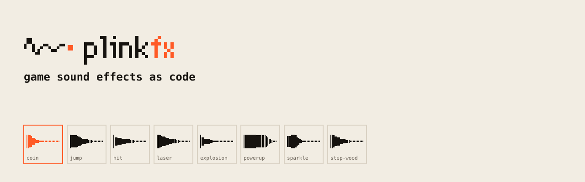
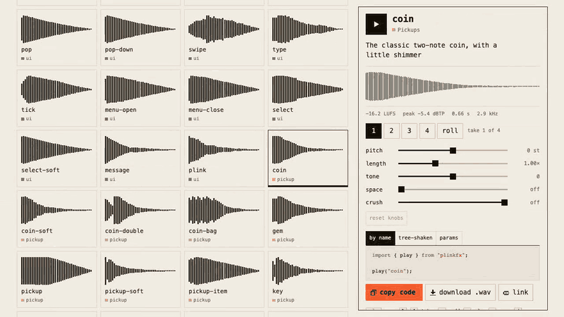

<picture>
  <source media="(prefers-color-scheme: dark)" srcset="brand/banners/readme-dark.svg">
  
</picture>

**<!-- count -->163<!-- /count --> game sound effects, written as code.** Coins, jumps, hits, lasers, explosions,
UI clicks and the rest of what a game needs, each one a few readable numbers that a 2.8 kB player turns into sound.
CC0, no audio files, no account.

<a href="https://maximilianfeix.github.io/plinkfx/"></a>

**[▶ Hear all <!-- count -->163<!-- /count --> in your browser](https://maximilianfeix.github.io/plinkfx/)** (one click per sound, tweak any of them and share the link) · [play the 30-second demo game](https://maximilianfeix.github.io/plinkfx/game.html) · [watch the 30 s video with sound](docs/media/hero-16x9.mp4)

```bash
npm i plinkfx
```

```js
import { play } from "plinkfx";

play("coin");
```

Each sound has four takes, and `play` picks a different one from the last, so the hundredth coin doesn't
sound like a loop.

<details>
<summary>More ways to play: options, game setup, tree-shaking, your own sound</summary>

**By name** (every sound included, 13.5 kB gzipped):

```js
import { play, volume } from "plinkfx";

play("laser");
play("coin", { volume: 0.5, rate: 1.2 });   // quieter, a bit higher
play("step-wood", { variant: 2 });          // a specific take (0-3)
play("step-wood", { pan: -0.6 });           // to the left
play("coin", { delay: 0.1 });               // 100 ms later
volume(0.8);                                // master volume, 0 mutes
```

**In a game:** browsers keep audio locked until the first click or key press. `unlockAudio()` resumes
it on that first gesture (and on iOS lets sounds play with the silent switch on). Sounds triggered
before that are skipped, not saved up into one loud burst. `preload()` renders sounds in idle time so
the first play has no delay; `stopAll()` is for pause screens.

```js
import { play, preload, stopAll, unlockAudio } from "plinkfx";

unlockAudio();
preload(["jump", "coin", "hit", "explosion"]);
// ...
stopAll();
```

Everything is safe to import on the server (Next.js, Nuxt, SvelteKit): `play()` and `volume()` do
nothing there.

**Only what you use** (player plus one sound: 2.7 kB gzipped). Importing anything from `"plinkfx"`
includes every sound, so use the subpaths when size matters:

```js
import { play } from "plinkfx/core";
import { coin, jump } from "plinkfx/sounds";

play(coin);
```

**Your own sound** is a plain object. Tweak any sound in the gallery, open the "params" tab and paste:

```js
import { play } from "plinkfx/core";

const blip = {
  layers: [
    { wave: "square", duty: 0.25, freq: 988, arp: [0, 5], arpRate: 0.07, h: 0.05, d: 0.3, lp: 7000 },
    { wave: "sine", freq: 1976, arp: [0, 5], arpRate: 0.07, d: 0.22, gain: 0.5 },
  ],
  verb: [0.2, 0.12],
};
play(blip);
```

All fields are documented in [skills/plinkfx/reference.md](skills/plinkfx/reference.md).

**React**, a two-line hook is enough:

```js
import { play } from "plinkfx";
const useSfx = (name) => useCallback((opts) => play(name, opts), [name]);
```

**Without a bundler** (after the npm release):

```html
<script type="module">
  import { play } from "https://esm.sh/plinkfx";
  document.body.onclick = () => play("coin");
</script>
```

</details>

## What's inside

<!-- catalog -->
| Category | Sounds | Examples |
|---|---:|---|
| UI | 23 | `click` `click-soft` `toggle-on` `confirm` `error` `notify` `swipe` `plink` |
| Pickups | 15 | `coin` `coin-double` `coin-bag` `gem` `key` `heart` `ka-ching` |
| Jump & land | 10 | `jump` `jump-double` `jump-cartoon` `land` `land-heavy` `spring` |
| Hits | 15 | `hit` `hit-heavy` `punch` `hurt` `enemy-die` `sword-hit` `block` `crit` |
| Explosions | 10 | `explosion` `explosion-big` `explosion-retro` `firework` `implosion` |
| Power-ups | 12 | `powerup` `level-up` `extra-life` `shield-on` `heal` `charge-up` |
| Shots & lasers | 16 | `laser` `blaster` `zap` `pew` `gunshot` `ricochet` `railgun` `reload` |
| Footsteps | 10 | `step-grass` `step-stone` `step-wood` `step-metal` `step-snow` `step-water` |
| Magic | 12 | `sparkle` `spell-cast` `fireball` `ice` `teleport` `portal` `lightning` |
| Alerts | 10 | `alarm` `warning` `low-health` `heartbeat` `countdown` `radar-ping` |
| Jingles | 9 | `victory` `checkpoint` `level-complete` `game-over` `secret-found` `achievement` |
| Doors & mechanics | 10 | `door-open` `door-heavy` `lock-open` `chest-open` `lever` `ratchet` |
| World | 11 | `whoosh` `swing` `splash` `water-drop` `bubble` `wind` `glass-break` |
<!-- /catalog -->

Every sound with a one-line description: `npx plinkfx list`, or the [gallery](https://maximilianfeix.github.io/plinkfx/).

## Files for your engine

Godot, Unity, Phaser, Defold, LÖVE or anything else that loads audio files.

**[Download every sound as WAV + OGG (zip)](https://github.com/maximilianfeix/plinkfx/releases/latest/download/plinkfx-wav-ogg.zip)**,
all four takes, 48 kHz mono, in category folders. No install needed. Or render them yourself:

```bash
npx plinkfx export sfx/                       # every sound as 48 kHz mono WAV, in category folders
npx plinkfx export sfx/ --format both         # WAV + OGG (OGG needs ffmpeg)
npx plinkfx export sfx/ --variants            # all four takes of each sound
npx plinkfx render explosion-big -o boom.wav  # one sound
```

- **Godot:** drop the folder into `res://` and turn the importer's *Normalize* off. The levels are already matched.
- **Unity:** WAV with *Decompress On Load* for short effects. The files are mono already.
- **Phaser:** `this.load.audio("coin", ["sfx/pickup/coin.ogg", "sfx/pickup/coin.wav"])`, or skip files
  and call `play("coin")` from plinkfx.

Each sound in the gallery also has a "download .wav" button. Ready-made players for the exported files:
[Godot](examples/godot), [Unity](examples/unity), and a [Phaser](examples/phaser) example that needs no files at all.

### One audio sprite (Phaser, Howler)

For the web, one file with every sound means one request instead of 163:

```bash
npx plinkfx export public/sfx --sprite --format both           # all sounds, 0.1 s of silence between them
npx plinkfx export public/sfx --sprite --only ui,pickup        # only some categories
```

That writes `plinkfx-sprite.ogg` and `plinkfx-sprite.wav` (take 0 of each sound, back to back),
`plinkfx-sprite.phaser.json` (Phaser's audio sprite format) and `plinkfx-sprite.json` (Howler's `sprite` map,
`{ "coin": [offsetMs, durationMs] }`). Sprite names are the sound names. `--gap 0.25` changes the silence between sounds.

```js
// Phaser 3 or 4
preload() {
  this.load.audioSprite("sfx", "sfx/plinkfx-sprite.phaser.json", ["sfx/plinkfx-sprite.ogg", "sfx/plinkfx-sprite.wav"]);
}
create() {
  this.sound.playAudioSprite("sfx", "coin");
}
```

```js
// Howler
import { Howl } from "howler";
const sprite = await (await fetch("sfx/plinkfx-sprite.json")).json();
const sfx = new Howl({ src: ["sfx/plinkfx-sprite.ogg", "sfx/plinkfx-sprite.wav"], sprite });
sfx.play("coin");
```

## The agent skill

plinkfx ships a skill for Claude Code, Codex, Cursor and other agents. Ask for *"a heavy door for a dungeon
level"* and the agent starts from the nearest catalogue sound, writes a parameter file, renders it, measures
it against that reference (loudness, true peak, duration, brightness) and adjusts. It runs on the CLI, offline.
Agents can't hear, so the skill tells yours to say so and hand you the WAV to judge.


```bash
npx skills add maximilianfeix/plinkfx                 # Claude Code, Codex, Cursor and others
```

In Claude Code you can also add the repo as a plugin marketplace:

```
/plugin marketplace add maximilianfeix/plinkfx
/plugin install plinkfx@plinkfx
```

A full run, with the real terminal output, is in [docs/skill-example.md](docs/skill-example.md).

## How the sounds are measured

`npm run bake` renders and levels every sound, and the test suite checks all four takes of each one on
Linux, macOS and Windows:

- **Loudness:** each category has a target, measured as max momentary loudness per ITU-R BS.1770
  (UI and footsteps −20 LUFS, hits −15, explosions −14, the rest in between). The four takes of a sound
  stay within ±1.5 LU of the target and average within 0.5 LU. Short transients such as clicks, hits and
  steps often reach the peak ceiling first; those sit below the target and are marked `limited` in the catalogue.
- **Peaks:** true peak (4× oversampled) ≤ −1 dBTP for every take.
- **The meter itself:** tested against the BS.1770 reference sine, and it agrees with ffmpeg's `ebur128`
  filter (`explosion-big`: −19.9 LUFS integrated in both).
- **Clean edges:** at least 1 ms attack, a 5 ms fade at the end, a DC blocker, the silent tail trimmed.
- **Determinism:** the same parameters and take always give the same samples. A hash of every take
  is part of the tests.
- **Variation:** the four takes differ (pitch spread per sound, slightly different decay, new noise).
- **Ears:** numbers can't tell a good sound from a dull one. A spectrogram of every category is checked
  during development (`npm run bake -- --reels`), but a headphone pass over all sounds isn't finished yet.
  If one sounds wrong to you, [open an issue](https://github.com/maximilianfeix/plinkfx/issues) with its name.

The meter is exported too: `import { measure } from "plinkfx/meter"`, or `npx plinkfx measure file.wav`
for any WAV.

## How it compares

sfxr (DrPetter, 2007) started this genre, and these are the tools most people reach for today:

| | **plinkfx** | [ZzFX](https://github.com/KilledByAPixel/ZzFX) | [jsfxr](https://github.com/chr15m/jsfxr) | [Kenney audio packs](https://kenney.nl/assets/category:Audio) |
|---|---|---|---|---|
| What it is | named sound library as code | tiny synth + designer | sfxr port: generator + library | WAV/OGG asset packs |
| Size (gzip) | 2.8 kB player, 13.5 kB with all sounds | ~1.3 kB | ~6.3 kB | no code, files |
| Licence | CC0 sounds, MIT code | MIT | Unlicense | CC0 |
| Named sounds | <!-- count -->163<!-- /count --> | 4 examples, random generators | random generators per category | many, generic file names |
| Matched loudness | yes, measured in tests | no | no | not stated |
| Same input, same samples | yes, seeded and hash-tested | only with randomness set to 0 | per saved parameter set | fixed files |
| Variations | 4 seeded takes per sound | edit or randomise | mutate | separate files |
| Export | WAV, OGG, CLI | WAV (designer) | WAV | already files |

ZzFX is smaller and the right pick for js13k. jsfxr is great for exploring random sounds. Kenney
packs have real recordings. plinkfx is for when you want a finished set that sounds consistent and that you
can read, tweak and ship. Also have a look at [8bit-sfx](https://github.com/cportka/8bit-sfx) and
[make-sfx](https://github.com/Tuntii/make-sfx) (game sounds as code), [uisfx](https://github.com/romainsimon/uisfx)
(UI sounds), and [earshot](https://github.com/Leonxlnx/earshot) if you want an agent to listen to audio.

## Licence

<table><tr><td>

### Sounds: CC0 1.0, public domain

Use them in any game, app, video or stream, commercial or not. **No credit needed.**
[LICENSE-SOUNDS](LICENSE-SOUNDS)

</td><td>

### Code: MIT

The engine, CLI, gallery and skill.
[LICENSE](LICENSE)

</td></tr></table>

## Contributing

New sounds are the best contribution: open the gallery, tweak something until it fits a moment in
your game, and open an issue or PR with the params. Look for issues labelled
[`good first issue`](https://github.com/maximilianfeix/plinkfx/labels/good%20first%20issue) and
[`new sound`](https://github.com/maximilianfeix/plinkfx/labels/new%20sound).
See [CONTRIBUTING.md](CONTRIBUTING.md).

[中文说明](README.zh-CN.md)
