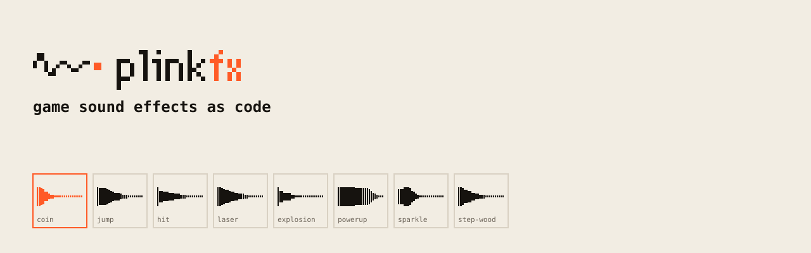
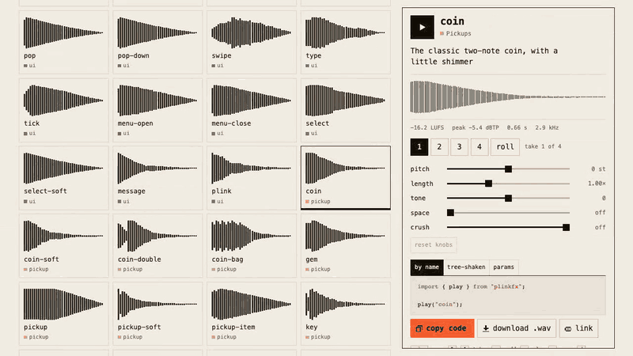

<picture>
  <source media="(prefers-color-scheme: dark)" srcset="brand/banners/readme-dark.svg">
  
</picture>

# plinkfx

**<!-- count -->161<!-- /count --> 个游戏音效，全部用代码写成。** 金币、跳跃、打击、激光、爆炸、UI 点击……每个音效只是几个看得懂的参数，由 2.3 kB 的播放器在浏览器里实时合成。音效 CC0，可商用，无需署名；没有音频文件，无需注册。

<a href="https://maximilianfeix.github.io/plinkfx/"></a>

**[▶ 在线试听全部音效](https://maximilianfeix.github.io/plinkfx/)** · [30 秒小游戏演示](https://maximilianfeix.github.io/plinkfx/game.html) · [30 秒有声视频](docs/media/hero-16x9.mp4)

```bash
npm i plinkfx
```

```js
import { play } from "plinkfx";

play("coin");
```

每个音效有 4 个变体，每次播放都会换一个和上次不同的，第一百个金币也不会听起来像在循环。

只打包用到的音效（播放器 + 一个音效约 2.2 kB gzip）：

```js
import { play } from "plinkfx/core";
import { coin, jump } from "plinkfx/sounds";

play(coin);
play(jump, { volume: 0.5 });
```

## 包含哪些音效

<!-- catalog -->
| 分类 | 数量 | 示例 |
|---|---:|---|
| UI | 23 | `click` `toggle-on` `confirm` `error` `notify` `plink` |
| 拾取 | 15 | `coin` `coin-double` `gem` `key` `heart` `ka-ching` |
| 跳跃与落地 | 10 | `jump` `jump-double` `land` `land-heavy` `spring` |
| 打击 | 15 | `hit` `hit-heavy` `punch` `hurt` `enemy-die` `sword-hit` |
| 爆炸 | 10 | `explosion` `explosion-big` `explosion-retro` `firework` |
| 强化 | 12 | `powerup` `level-up` `extra-life` `shield-on` `heal` |
| 射击与激光 | 14 | `laser` `blaster` `zap` `pew` `gunshot` `reload` |
| 脚步 | 10 | `step-grass` `step-stone` `step-wood` `step-snow` |
| 魔法 | 12 | `sparkle` `fireball` `ice` `teleport` `lightning` |
| 提示 | 10 | `alarm` `warning` `low-health` `countdown` |
| 短旋律 | 8 | `victory` `level-complete` `game-over` `achievement` |
| 门与机关 | 10 | `door-open` `door-heavy` `chest-open` `lever` |
| 环境 | 12 | `whoosh` `splash` `water-drop` `wind` `glass-break` |
<!-- /catalog -->

## 导出给游戏引擎

Godot、Unity、Phaser、Defold、LÖVE 等引擎都可以直接用导出的文件：

```bash
npx plinkfx export sfx/                 # 每个音效导出为 48 kHz 单声道 WAV，按分类放在子文件夹
npx plinkfx export sfx/ --format both   # WAV + OGG（OGG 需要 ffmpeg）
npx plinkfx export sfx/ --variants      # 每个音效的全部 4 个变体
```

Godot 导入时请关闭 *Normalize*，响度已经统一过了。[Godot](examples/godot)、[Unity](examples/unity)、[Phaser](examples/phaser) 都有现成的示例。

## Agent 技能

支持 Claude Code、Codex、Cursor 等。描述你想要的声音（例如“地牢里沉重的大门”），Agent 会从最接近的现有音效出发写出参数，然后渲染、测量（响度、真峰值、时长、亮度）并调整，完全离线运行。Agent 听不到声音，所以最后由你来试听。

```bash
npx skills add maximilianfeix/plinkfx
```

完整示例见 [docs/skill-example.md](docs/skill-example.md)。

## 怎么测量

- 每个分类有响度目标（ITU-R BS.1770 最大瞬时响度），4 个变体都在目标 ±1.5 LU 以内。很短的点击、打击、脚步声会先碰到峰值上限，响度会略低于目标。
- 真峰值 ≤ −1 dBTP，无直流偏移，首尾无爆音。
- 同样的参数总是生成相同的采样，测试里有哈希校验，在 Linux、macOS、Windows 上运行。
- 数字说明不了好不好听。用耳机逐个试听全部音效的工作还没做完；如果哪个听起来不对，欢迎[提 issue](https://github.com/maximilianfeix/plinkfx/issues)。

## 对比

ZzFX 更小，适合 js13k；jsfxr 适合随机探索音色；Kenney 音效包是真实录音。plinkfx 适合想要一整套风格统一、能读懂、能修改、能直接上线的音效的人。详细对比表见 [English README](README.md#how-it-compares)。

## 授权

### 音效：CC0 1.0（公共领域）

可用于任何游戏、应用、视频、直播，商用也可以，**无需署名**。[LICENSE-SOUNDS](LICENSE-SOUNDS)

### 代码：MIT

引擎、CLI、在线音效库和技能。[LICENSE](LICENSE)

## 参与贡献

最有用的贡献是新音效：在[在线音效库](https://maximilianfeix.github.io/plinkfx/)里调到适合你游戏的样子，把参数发 issue 或 PR。见 [CONTRIBUTING.md](CONTRIBUTING.md)。

## Star 历史

<a href="https://star-history.com/#maximilianfeix/plinkfx&Date"></a>

[English README](README.md)
